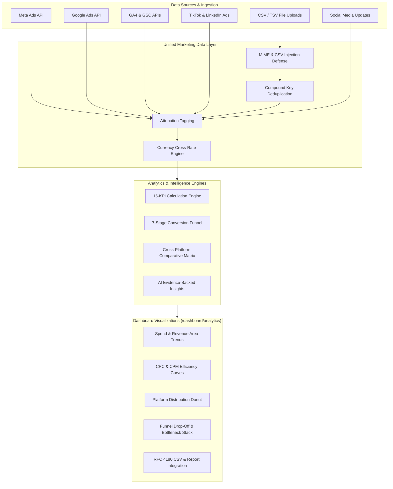

# Advanced Analytics & Multi-Channel Intelligence Architecture

> **Sparkline Marketing Intelligence & Strategy Platform — Phase 23**

---

## 1. Executive Overview

The **Sparkline Advanced Analytics Engine** provides a unified marketing data layer that aggregates, normalizes, and analyzes performance data across disparate advertising networks (Meta Ads, Google Ads, TikTok Ads, LinkedIn Ads), search console feeds (Google Search Console), website analytics (GA4), organic social channels, and custom spreadsheet imports.

The architecture eliminates fragmented reporting silos by standardizing marketing metrics into a consistent internal schema, performing real-time multi-currency normalization, calculating multi-stage conversion funnels, and delivering automated AI insights backed by verifiable mathematical evidence.

---

## 2. Analytics Pipeline Architecture



---

## 3. The 15 Core Marketing Performance KPIs

The analytics engine processes and displays 15 standard marketing metrics. When underlying data is unavailable (such as blended non-ad overhead for CAC), the metric is honestly flagged rather than estimated:

| KPI Metric | Calculation Formula | Units | Provenance Default | Interpretation / Business Context |
| :--- | :--- | :--- | :--- | :--- |
| **Total Ad Spend** | $\sum \text{Daily Media Spend}$ | Currency | Connected / Imported | Direct cash investment across paid platforms. |
| **Total Impressions** | $\sum \text{Ad Views Served}$ | Integer | Connected / Imported | Gross top-of-funnel exposure. |
| **Total Reach** | $\sum \text{Unique Individuals}$ | Integer | Connected / Estimated | Unduplicated audience count exposed to media. |
| **Total Clicks** | $\sum \text{Outbound Link Clicks}$ | Integer | Connected / Imported | Raw traffic volume routed to landing destinations. |
| **Click-Through Rate (CTR)** | $\frac{\text{Clicks}}{\text{Impressions}} \times 100$ | Percentage | Calculated | Creative engagement and hook resonance. |
| **Average Cost Per Click (CPC)** | $\frac{\text{Spend}}{\text{Clicks}}$ | Currency | Calculated | Traffic acquisition efficiency. |
| **Average CPM** | $\frac{\text{Spend}}{\text{Impressions}} \times 1000$ | Currency | Calculated | Audience cost per one thousand impressions. |
| **Inbound Leads** | $\sum \text{Lead Gen Form Fills}$ | Integer | Connected / Imported | Prospective customers submitting contact details. |
| **Conversions / Orders** | $\sum \text{Purchases / Registrations}$ | Integer | Connected / Imported | Primary bottom-of-funnel commercial events. |
| **Conversion Rate (CVR)** | $\frac{\text{Conversions}}{\text{Clicks}} \times 100$ | Percentage | Calculated | Landing page efficiency and purchase intent. |
| **Cost Per Acquisition (CPA)** | $\frac{\text{Spend}}{\text{Conversions}}$ | Currency | Calculated | Direct advertising cost per customer order. |
| **Attributed Revenue** | $\sum \text{Order Value}$ | Currency | Connected / Imported | Realized monetary transactions attributed to media. |
| **Return On Ad Spend (ROAS)** | $\frac{\text{Revenue}}{\text{Spend}}$ | Multiplier ($x$) | Calculated | Gross revenue generated per dollar spent. |
| **Ad Return On Investment (ROI)** | $\frac{\text{Revenue} - \text{Spend}}{\text{Spend}} \times 100$ | Percentage | Calculated | Net marketing profitability percentage. |
| **Blended CAC** | $\frac{\text{Spend} + \text{Sales Overhead}}{\text{New Customers}}$ | Currency | Unavailable (Flagged) | Requires non-ad payroll; honestly disclosed as N/A. |

---

## 4. The 7-Stage Conversion Funnel Mechanics

To prevent fragmented visibility between top-of-funnel reach and bottom-of-funnel checkout, Sparkline standardizes user progression across seven sequential milestones:

```
[1. Ad Impressions] ─────────┐
    ↓ (CTR %)                │ Top-of-Funnel Media Exposure
[2. Ad Clicks]               │
    ↓ (88% Arrival Rate)     │
[3. Website Sessions] ───────┘
    ↓ (Session-to-Lead %)    ┐
[4. Inbound Leads]           │ Mid-Funnel Evaluation & Qualification
    ↓ (Qualification %)      │
[5. Qualified Leads (MQL)] ──┘
    ↓ (Lead-to-Order %)      ┐
[6. Customers / Orders]      │ Bottom-of-Funnel Monetization
    ↓ (AOV Realization)      │
[7. Realized Revenue] ───────┘
```

### Bottleneck Identification Algorithm
For every transition between stages $i$ and $i+1$:
$$\text{Progression Rate}_{i \to i+1} = \frac{\text{Count}_{i+1}}{\text{Count}_i} \times 100$$
$$\text{Drop-off Rate}_{i \to i+1} = 100\% - \text{Progression Rate}_{i \to i+1}$$

The system evaluates all stages $i \in [1, 5]$. The stage exhibiting the maximum drop-off rate is tagged as the **Primary Funnel Bottleneck** with high-visibility alert styling and an immediate tactical recommendation (e.g. page speed optimization, checkout friction elimination).

---

## 5. Cross-Platform Comparative Attribution Rules

When comparing performance across channels (e.g. Meta Ads vs. Google Ads vs. SEO), Sparkline enforces strict attribution transparency:

1. **Meta Ads Manager**: Operates on a native 7-day click and 1-day view attribution model.
2. **Google Ads**: Operates on a data-driven attribution (DDA) model across fractional search path touchpoints.
3. **Google Analytics 4 (GA4)**: Evaluates sessions using last non-direct click attribution.
4. **Organic Search (SEO)**: Clicks and impressions measured by Google Search Console at the SERP level.

> [!IMPORTANT]
> Sparkline never declares one platform "superior" based on mismatched attribution definitions. Comparisons standardize currency and mathematical ratios while explicitly citing native attribution windows.

---

## 6. Currency Normalization Architecture

When cross-platform campaigns are transacted in different currencies (e.g. Google Ads in USD, Meta Ads in EUR, TikTok in GBP), Sparkline normalizes all metrics into the user's selected project currency:
$$\text{Spend}_{\text{Target}} = \text{Spend}_{\text{Source}} \times \text{CrossRate}(\text{Source} \to \text{Target})$$

Cross-rates are derived from institutional ECB/Federal Reserve feeds cached in the database. Historical conversion snapshots preserve the timestamped exchange rate for financial auditability.

---

## 7. AI-Assisted Strategic Insights Engine

Every AI insight generated in the analytics workspace adheres to a strict five-tier provenance taxonomy:
- `[Measured Observation]`: Directly measured metric without alteration (e.g. "Blended ROAS is 3.82x").
- `[Calculated Finding]`: Mathematical derivation from two or more points (e.g. "CPA dropped 18.4% vs prior month").
- `[AI Interpretation]`: Strategic evaluation of underlying drivers (e.g. "Google Search is outperforming Meta lookalikes by 42% due to high intent").
- `[Recommendation]`: Prescriptive tactical action (e.g. "Reallocate 15% spend from underperforming ad sets").
- `[Hypothesis]`: Proposed experiment requiring split testing (e.g. "Testing problem-solution hooks will improve cold CTR by 20%").

Every insight includes an explicit **Supporting Evidence** citation that references the exact numbers, campaigns, and attribution windows that informed the finding.

