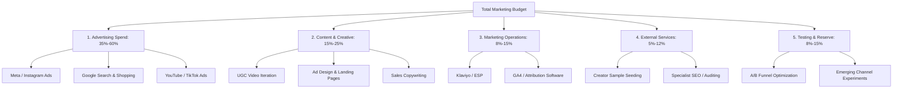

# Sparkline Budget Allocation Framework

## Strategic Rationale & Financial Architecture

The Sparkline Marketing Budget Allocation Framework provides a disciplined methodology for deploying marketing capital. It replaces guesswork, vanity metrics, and arbitrary budget splits with structural allocation ratios rooted in product stage, sales velocity, channel dynamics, and risk tolerance.

---

## 1. The 5 Core Budget Pillars

Marketing capital is partitioned into five distinct operational groups:

### Pillar Definitions:
1. **Advertising Spend (35% – 60%)**: Paid distribution across ad auctions (Meta, Google, TikTok, LinkedIn). Capital deployed here must be constrained by bid caps, cost-per-acquisition (CPA) targets, and return-on-ad-spend (ROAS) thresholds.
2. **Content and Creative (15% – 25%)**: Production of visual assets, unretouched video hooks, product demonstration carousels, and conversion-focused copy. Constraining creative spend while scaling ad spend guarantees rapid creative fatigue and rising acquisition costs.
3. **Marketing Operations (8% – 15%)**: Software tooling that powers retention and tracking, such as email/SMS platforms, customer data platforms, and analytics suites. Spending over 35% on operations indicates bloated SaaS overhead.
4. **External Services (5% – 12%)**: Specialized contractors, influencer gifting/seeding budgets, PR releases, and tactical agency contributors.
5. **Testing and Reserve (8% – 15%)**: Dedicated experimentation budget protected from core campaign reallocation. Used for landing page A/B tests, novel creative format exploration, and emergency buffers.

---

## 2. Strategic Profiles (Conservative vs. Balanced vs. Growth)

### A. Conservative Budget
* **Core Philosophy**: Protect cash runway; focus on high-intent search, email lifecycle, and organic proof.
* **Capital Profile**:
  - Advertising: ~45% (Focused strictly on Google Search & retargeting)
  - Creative: ~20% (Core video and photo assets)
  - Operations: ~15% (Essential email automation tools)
  - Services: ~10% (Micro-creator seeding)
  - Testing & Reserve: ~10% (CRO & message testing)
* **Risk Profile**: Minimal cash burn; acquisition velocity bounded by direct commercial search volume.

### B. Balanced Budget
* **Core Philosophy**: Integrated multi-channel customer acquisition and retention.
* **Capital Profile**:
  - Advertising: ~55% (Meta Ads 35%, Google Search 20%)
  - Creative: ~18% (4 monthly video iterations + graphic design)
  - Operations: ~10% (Email/SMS + tracking tools)
  - Services: ~7% (Creator outreach & seeding)
  - Testing & Reserve: ~10% (A/B testing + emerging channel discovery)
* **Risk Profile**: Predictable scaling; requires weekly CPA and ad creative refresh governance.

### C. Growth-Focused Budget
* **Core Philosophy**: Aggressive customer acquisition and market share expansion.
* **Capital Profile**:
  - Advertising: ~60% (Meta Ads, TikTok, Google Shopping, YouTube)
  - Creative: ~15% (High-volume UGC production pipeline)
  - Operations: ~8% (Enterprise analytics & CDP infrastructure)
  - Services: ~5% (Specialist creator agencies)
  - Testing & Reserve: ~12% (Multi-variant funnel experimentation)
* **Risk Profile**: High cash burn rate; requires stop-loss CPA limits and rapid statistical analysis.

---

## 3. Allocation Rule Matrix by Business Stage

| Stage | Advertising | Creative | Operations | Services | Testing & Reserve | Key Channel Mix |
|:---|:---|:---|:---|:---|:---|:---|
| **Pre-Launch / MVP** | 30% | 35% | 15% | 5% | 15% | Search Intent, Organic Content, Landing Page CRO |
| **Early-Stage (<$20k/mo)** | 45% | 25% | 12% | 8% | 10% | Meta Ads, High-Intent Google Search, Klaviyo Email |
| **Growing ($20k–$100k/mo)** | 55% | 18% | 10% | 7% | 10% | Meta Advantage+, Google Shopping, TikTok UGC, Lifecycle SMS |
| **Scale-Up (>$100k/mo)** | 60% | 15% | 8% | 5% | 12% | Omnichannel Paid, Influencer Retargeting, High-Velocity CRO |

