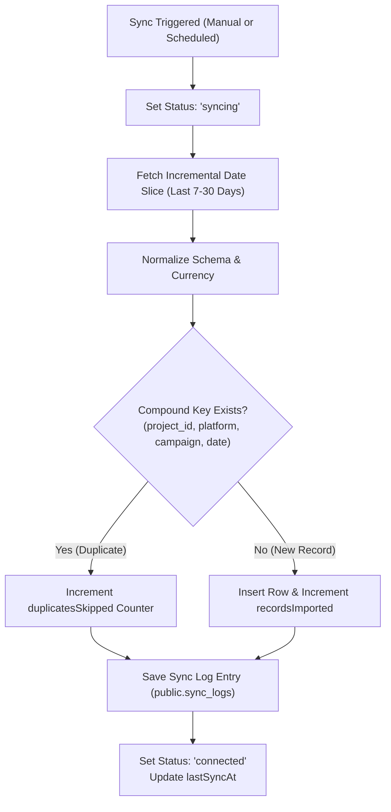

# Data Synchronization Architecture

> **Sparkline Marketing Intelligence & Strategy Platform — Phase 23**

---

## 1. Overview & Objectives

The **Sparkline Data Synchronization Engine** orchestrates scheduled and on-demand data extraction from connected platforms into the platform's unified marketing schema.

Key architectural objectives:
1. **Zero Duplicate Ingestion**: Ingesting the same date range repeatedly must never create duplicated metric records.
2. **Deterministic Immutability**: Historical performance data is preserved unless an explicit update/reconciliation event occurs.
3. **Graceful Error Recovery**: Network drops and API rate limits record detailed sync failures without corrupting previously synced records.
4. **Manual Adjustment Preservation**: Custom manual inputs and campaign adjustments are tagged distinctly and protected from automated overwrite.

---

## 2. Ingestion Flow & Deduplication Engine

---

## 3. Compound Key Deduplication Logic

Every performance data point is indexed by a deterministic compound unique key:
$$\text{CompoundKey} = \text{ProjectID} + \text{"\_"} + \text{Platform} + \text{"\_"} + \text{CampaignName} + \text{"\_"} + \text{Date}$$

Before writing incoming rows from CSV files, Google Ads, or Meta APIs, the synchronization worker computes the compound key against the existing in-memory/database set:
- If key is present: Row is treated as an idempotent duplicate and skipped, or updated if explicit reconciliation is requested.
- If key is absent: Key is added to the set and row is safely committed.

This guarantees that clicking "Sync Now" multiple times or re-uploading the same spreadsheet does not artificially inflate spend, clicks, or conversions.

---

## 4. Manual vs. Automated Synchronization

| Capability | Manual Synchronization | Automated Scheduled Sync |
| :--- | :--- | :--- |
| **Trigger Mechanism** | User clicks "Sync Now" in UI | Background Cron Worker |
| **Sync Window** | User-selected date range or last 30 days | Incremental rolling 48-hour window |
| **Execution Context** | Synchronous UI progress with toast alert | Asynchronous headless background job |
| **Rate Limit Backoff** | Immediate user alert if rate limit hit | Exponential backoff (1m, 5m, 15m) |
| **Audit Logging** | Recorded in `public.audit_logs` & `public.sync_logs` | Recorded in `public.sync_logs` |

---

## 5. Sync Error Handling & Retries

When third-party APIs return errors (e.g. Meta Graph API error code 17 "User request limit reached" or Google Ads `RESOURCE_EXHAUSTED`):
1. Worker terminates the current batch safely without dropping already-committed rows.
2. Connection status transitions to `sync_failed`.
3. Error message and HTTP status code are logged in `public.sync_logs.error_message`.
4. User interface presents a descriptive alert pill with a single-click "Retry" action.
5. In-app notification alert is pushed to the user's notification popover.

