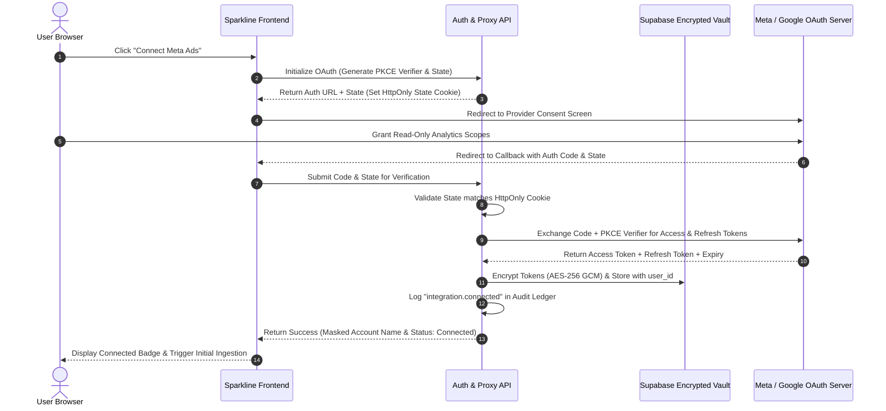

# OAuth Security & Credential Protection Guide

> **Sparkline Marketing Intelligence & Strategy Platform — Phase 23**

---

## 1. OAuth Security Principles

Sparkline implements enterprise-grade OAuth 2.0 and PKCE (Proof Key for Code Exchange) standards when connecting external marketing platforms. The architecture enforces zero client-side credential exposure and strict least-privilege scoping:

1. **Proof Key for Code Exchange (PKCE)**: Mandatory for public and single-page clients to eliminate authorization code interception attacks.
2. **Cryptographic State Parameter**: High-entropy pseudo-random state string generated per authorization request to neutralize Cross-Site Request Forgery (CSRF).
3. **Least-Privilege Scoping**: Only read-only analytics scopes (`ads_read`, `read_insights`, `analytics.readonly`) are requested. Sparkline never requests billing management, user write access, or campaign deletion permissions.
4. **Server-Side Token Exchange**: Frontend code receives only authorization codes, never direct access tokens. Token exchange happens strictly server-side over TLS 1.3.
5. **Encryption at Rest**: Tokens are encrypted using AES-256 GCM in Supabase Vault before being committed to PostgreSQL.
6. **Zero Browser Leakage**: Encrypted tokens are never returned in client JSON responses. The frontend UI queries only account names, masked IDs (e.g. `act_meta_***840`), and sync statuses.

---

## 2. Authorization Flow Diagram



---

## 3. PKCE Verifier & State Generation Implementation

```typescript
// Cryptographic state generator
function generateSecureOAuthState(): string {
  const buffer = new Uint8Array(32);
  crypto.getRandomValues(buffer);
  return Array.from(buffer, (b) => b.toString(16).padStart(2, '0')).join('');
}

// PKCE Code Challenge generator (SHA-256)
async function generateCodeChallenge(codeVerifier: string): Promise<string> {
  const encoder = new TextEncoder();
  const data = encoder.encode(codeVerifier);
  const digest = await crypto.subtle.digest('SHA-256', data);
  return btoa(String.fromCharCode(...new Uint8Array(digest)))
    .replace(/\+/g, '-')
    .replace(/\//g, '_')
    .replace(/=+$/, '');
}
```

---

## 4. Credential Redaction & Audit Safeguards

All operational audit logs generated during connection, synchronization, and token rotation automatically strip sensitive authorization headers, passwords, and secret keys:

```typescript
const SENSITIVE_FIELDS = ['password', 'token', 'secret', 'key', 'hash', 'credential'];

function redactAuditMetadata(metadata: Record<string, unknown>): Record<string, unknown> {
  const clean: Record<string, unknown> = {};
  for (const [key, value] of Object.entries(metadata)) {
    if (SENSITIVE_FIELDS.some((field) => key.toLowerCase().includes(field))) {
      clean[key] = '[REDACTED]';
    } else {
      clean[key] = value;
    }
  }
  return clean;
}
```

---

## 5. Token Revocation & Disconnection Workflow

When a user clicks **Disconnect**:
1. Server issues a revocation POST request to the provider's token revocation endpoint (e.g. `https://oauth2.googleapis.com/revoke` or Meta Graph API `DELETE /me/permissions`).
2. Encrypted tokens are permanently deleted from `public.user_integrations`.
3. Connection status is updated to `disconnected`.
4. Operational event `integration.disconnected` is logged in `public.audit_logs`.
5. Future scheduled sync workers immediately skip the provider.

